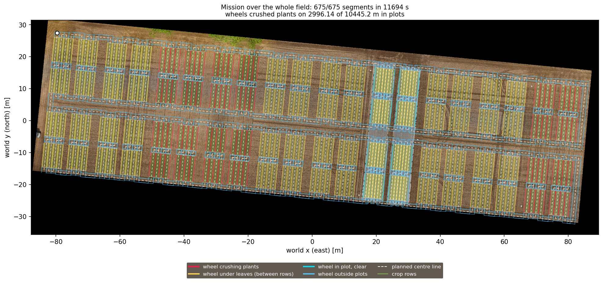

# Agricultural UGV simulation (work in progress)

[](https://github.com/abshahidthe01-afk/agri-ugv-sim/actions/workflows/ci.yml)

A four-wheel-steering field robot in simulation, built to drive between crop
rows on real terrain. ROS 2 Humble and Gazebo Fortress.


## Status

- Thorvald-style robot model with suspension ([robot spec](docs/robot_spec.md))
- Four-wheel-steering kinematics, unit-tested
- Gazebo simulation with ros2_control, speed limits and a watchdog
- Four-wheel-steering driver as a C++ ros2_control controller (steer first, speed
  limits, stall recovery, wheel odometry); the same logic as the Python driver nodes,
  which remain an option (`controller:=python`). On plot 198 both drive the same
  (102.7 / 102.8 s, 1.3 / 1.4 cm from the line), and without the two Python nodes the
  simulation runs faster (real-time factor 0.64 against 0.57)
- Ground-truth pose and velocity from Gazebo
- Terrain generator: test terrains and the real MuST-C field from drone elevation data
- Field: the 80 plots of the real MuST-C trial from its official shapefile, with
  generated crop plants (textured leaves, about 22,500 plants); the drilled cereals have
  tramlines, unsown rows where the robot's wheels run
- Localization: own EKF fusing RTK GNSS (two antennas: position and heading), IMU,
  wheel odometry and the crop rows measured in the 3D LiDAR; the pose also goes out as TF
- 3D LiDAR on a mast: the mission stands still while an obstacle is in its way, and the
  rows node measures the robot's place across the crop rows
- Autonomous coverage mission: passes over every plot, driven without turning
  (four-wheel steering: forwards, backwards and sideways), with steer-first driving
  and recovery from steering stalls
- Crop damage metric: wheel travel over the crop rows
- Plant map from the two laser line scanners: cover and canopy height per plot, compared
  with the generated plants; crop rows in the map show localization errors; and a 3D point
  cloud of every plot, its points a median 1.0 cm from the true leaves
  ([plant map](docs/plant_map.md))
- Camera and laser fusion: the dome cameras colour the 3D points (plant colour on 96 % of the
  points on leaves, 1 % of those on the soil), shown live in RViz with the robot model
- 3D reconstruction from the dome cameras: at a stop, the 20 cameras' depth images fused into
  a coloured mesh of the plants, its leaf points a median 1.9 mm from the true leaves (the
  depth is simulated exactly; see the [plant map](docs/plant_map.md))

## Results: the whole field

The final run drove the coverage mission over all 80 plots with everything on: the C++
driver, the 3D LiDAR (obstacle stop and crop rows), both line scanners, the 4 top dome
cameras colouring the 3D points and the plant map; Gazebo without its window
(`gui:=false`).

| | Final run |
|---|---|
| Segments | 675 of 675 (4.09 km driven, 4.03 km planned) |
| Simulated time | 3.25 h, of which 0.58 h false obstacle stops (see Limitations) |
| Wall-clock time | 4.7 h (real-time factor 0.69) |
| Robot centre to the planned line, mean / 95 % | 1.2 / 4.0 cm |
| Localization error, mean / 95 % | 1.3 / 2.5 cm; across the rows 0.8 / 1.9 cm; the uncertainty it reports fits ((error/sigma)² 2.0, about 2 expected) |
| Crop rows found in the LiDAR | the right row in 100 % of 37,662 scans (potato, soybean, sugar beet, sugar corn) |
| Wheels crushing plants | 28.7 % of the wheel travel in plots, all but 1.9 m in the drilled cereals and mixtures (no gap between rows for a wheel; 11.7 % of their area flattened); none in potato, sugar beet and sugar corn |
| Plant map against the generated plants | 80 plots, 70 % of each seen; cover within -9 to +7 points, canopy height within -2.8 to +6.0 cm ([plant map](docs/plant_map.md)) |
| 3D point clouds | 80 plots (235 MB of PLY), coloured from 93,489 dome pictures |

The first whole-field run, with an earlier version of the software, took 2.85 h of
simulated time for 643 segments, with 1.9 cm mean localization error and plants
crushed on 32.5 % of the wheel travel in plots.



## Limitations

- The plants are generated, not measured: shapes, sizes and row spacings are assumed.
  Cereal rows are picture strips, so their height reads 3-6 cm high.
- The line scanners take 10 profiles per second (the real ones 200), 5 cm apart along the
  rows: about half of the leaves' top surface has a point within 2 cm. More profiles
  overload the simulation on the GTX 1650 used here.
- The dome cameras give 640 x 480 pictures (the real ones 45 megapixels) of plants in the
  roof's shade (the LED panels give no light). The 3D reconstruction uses Gazebo's exact
  depth images instead of matching the pictures, and covers one stop.
- In the final run the robot stopped 40 times (2,070 s) for obstacles that were not there:
  Gazebo's LiDAR returns one beam, straight behind the robot at the seam of its view, about
  30 cm too far. That point lies below the ground, and measured from it the tallest sweet
  corn stood 1 m high while the robot drove backwards. The obstacle stop now ignores a single
  stray point; plot 172 drives through without a stop since (the whole field has not been
  run again).
- The published pose sometimes jumps for one or two samples (61 times in 3.25 h, up to 15 cm
  for 20 ms) and comes back; without these the largest error was 6.2 cm. The cause is not
  found yet.
- GNSS errors, wheel slip and soil are simulated models; the field run had RTK fixed GNSS
  throughout.

## Quick start

```bash
git clone https://github.com/abshahidthe01-afk/agri-ugv-sim.git agri_ugv_ws
cd agri_ugv_ws
rosdep install --from-paths src --ignore-src -y
colcon build --symlink-install
source install/setup.bash
ros2 run agri_ugv_field make_plants   # grows the crop plants (about 35 s, 380 MB)
colcon build --symlink-install --packages-select agri_ugv_gazebo
ros2 launch agri_ugv_gazebo sim.launch.py world:=must_c_field
```

Worlds: `flat` (default), `flat_mesh`, `waves`, `must_c_field`.

Or run the autonomous mission (one plot here; leave out `plots:=` for the whole field)
and start it from a second terminal:

```bash
ros2 launch agri_ugv_navigation mission.launch.py plots:=198
ros2 service call /mission/start std_srvs/srv/Trigger
```

Or drive it yourself from a second terminal:

```bash
source install/setup.bash
ros2 run teleop_twist_keyboard teleop_twist_keyboard
```

## Data and sources

The `must_c_field` terrain is derived from the MuST-C drone elevation map (DEM) and
aerial photo (orthophoto) of 17 May 2023: heights resampled to a 0.45 m grid using the
10th height percentile per cell, gaps outside the field filled, heights relative to the
field centre; the photo is used as the terrain's texture at 6 cm per pixel. The survey
ends about 1 m beyond the southern plots, so the terrain is extended by 3.6 m on every
side (edge heights continued) for the robot to drive around the field; where the photo
has no data, the texture is plain soil colour.
The plot layout (`src/agri_ugv_field/data/must_c_field_plots.csv`) comes from the
dataset's field shapefile (`md_FieldSHP`), placed in the same world frame. The crop
plants in the plots are generated: row spacings and plant sizes are assumed typical
values, not measured; leaf pictures and plant shapes are drawn by the generator.

- Dataset: Chong, Yue Linn, 2025, "MuST-C Dataset: The Multi-Sensor and Multi-Temporal
  Data Set of Multiple Crops for In-Field Phenotyping and Monitoring",
  https://doi.org/10.60507/FK2/OX9XTM, bonndata, V3. License: CC BY 4.0.
- Paper: Chong et al., Scientific Data, 2026, https://doi.org/10.1038/s41597-025-06462-y

Robot dimensions follow the Thorvald II (Grimstad & From, 2017) and the Bonn field
phenotyping robot (Esser et al., 2023).

## License

Code: MIT, see [LICENSE](LICENSE). The terrain and field layout files derived from
MuST-C are shared under CC BY 4.0, like their source.
