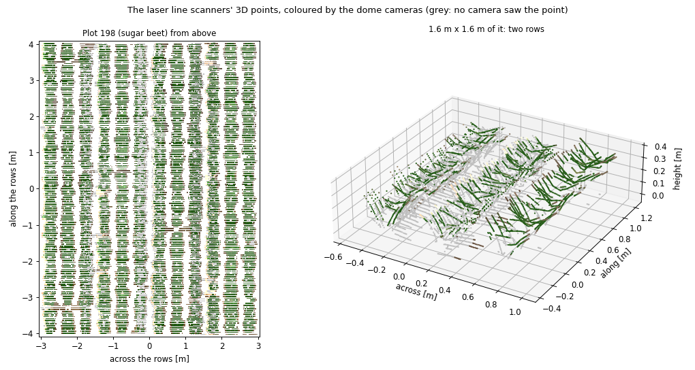
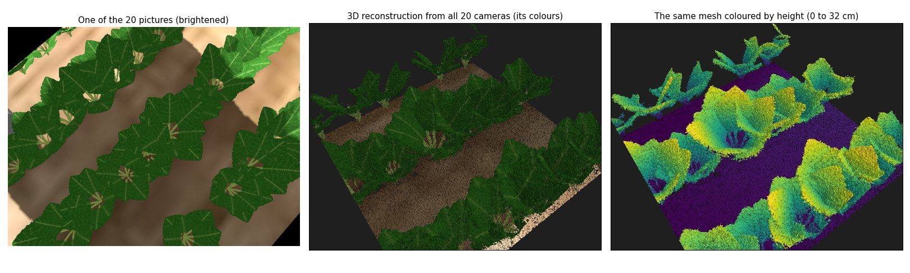

# Plant map

The two laser line scanners on the side panels (see the [robot spec](robot_spec.md)) measure
the plants while the robot drives its coverage passes. The `plant_map` node
(`agri_ugv_phenotyping`) places every scanner profile in the field with the robot's pose at
the profile's time and fills one raster per plot, 5 cm cells in the plot's own frame (along
the rows, across them). A point's height is its height above the plane the wheels stand on.
Per plot it reports:

- **seen**: share of the plot's cells with scanner points
- **cover**: share of the seen cells with plant points (more than 6 cm high)
- **canopy height**: 95th percentile (and median) of the plant cells' heights
- **rows off the field map**: where the rows lie in the map, across the plot, compared with
  where the field map puts them; and how sharply the plants line up on rows (0 to 1). A
  wrong pose moves the rows in the map, and passes that disagree blur them.

```bash
ros2 launch agri_ugv_phenotyping survey.launch.py plots:=198
ros2 service call /mission/start std_srvs/srv/Trigger
# when the mission is complete: ~/plant_maps/plant_map.npz and .json
ros2 run agri_ugv_phenotyping canopy_truth --map ~/plant_maps/plant_map.npz
```

`canopy_truth` grows the plots' plants again exactly as `make_plants` grew them for Gazebo
(same generator and seed) and compares the map with the true canopy: the highest drawn leaf
per cell, seen from above, on the cells the map has seen.

## Map and true canopy

RTK fixed GNSS, plots 198, 197, 188 and 187 (12726 profiles, about 630 s simulated), map placed
with Gazebo's true pose:

| Plot | Crop | Seen | Cover: truth / map | Canopy height: truth / map |
|---|---|---|---|---|
| 198 | Sugar beet | 73 % | 90 % / 96 % | 32.2 / 33.9 cm |
| 197 | Summer wheat | 63 % | 97 % / 97 % | 70.0 / 75.7 cm |
| 188 | Soybean | 76 % | 59 % / 57 % | 31.8 / 33.7 cm |
| 187 | Potato | 72 % | 81 % / 85 % | 42.3 / 43.3 cm |

Cover is within -1 to +6 points of the truth, canopy height within +1.0 to +5.7 cm. The map
placed with the robot's own pose estimate (0.9 cm mean error across the rows) is the same
within 3 points of cover and 0.1 cm of height. The scanners see the plants at a slant, so
part of each plot stays hidden behind leaves (seen 63-76 %).

The heights read high partly because the ground under the scanned strip lies up to 1.5 cm
above the plane of the wheels (median per plot and scanner -0.1 to +1.5 cm, measured in the
profiles). Wheat reads highest: its rows are picture strips whose top edge stands above the
drawn ears, and the scanners see the whole strip (below).

### The whole field

The final whole-field run (README) mapped all 80 plots, placed live with the robot's own
pose estimate; the map against the true canopy, per crop (mean over its plots):

| Crop | Plots | Seen | Cover: truth / map | Canopy height: map minus truth |
|---|---|---|---|---|
| Potato | 16 | 71 % | 80 % / 85 % | +1.0 cm (+0.6 to +1.5) |
| Sugar beet | 16 | 72 % | 89 % / 95 % | +1.5 cm (+1.0 to +2.5) |
| Sugar corn | 16 | 74 % | 75 % / 67 % | -2.0 cm (-2.8 to -1.4) |
| Soybean | 8 | 75 % | 59 % / 59 % | +1.9 cm (+1.7 to +2.1) |
| Summer wheat | 16 | 63 % | 98 % / 98 % | +4.6 cm (+3.2 to +5.6) |
| Mixtures (faba, faba-wheat, wheat) | 8 | 61-66 % | 97-98 % / 98 % | +3.6 to +5.9 cm |

Over all 80 plots cover is within -9 to +7 points of the truth and canopy height within
-2.8 to +6.0 cm (mean size of the difference 3.9 points and 2.5 cm). Sugar corn is the
only crop whose cover reads low (-7 to -9 points), probably because its long, narrow leaves
fall between profiles 5 cm apart.

### Why the leaves are shaped in the mesh

Gazebo's GPU lidar ignores the textures' transparency and the back sides of faces; the
cameras show neither. With leaves as plain textured cards, a ray cast of the two scanners
against the same meshes and terrain, at Gazebo's recorded true poses (550 profiles), matched
Gazebo only when it did the same:

| Plant points per profile, leaf cards | Sugar beet | Summer wheat | Soybean | Potato |
|---|---|---|---|---|
| Gazebo | 42 | 293 | 77 | 43 |
| Ray cast: whole cards, front side only | 43 | 293 | 79 | 43 |
| Ray cast: drawn leaves, both sides (as the cameras show them) | 154 | 256 | 94 | 105 |

The map then had cover 22 points too low in sugar beet and 13 in potato. So each leaf is
now four quads, each as wide as the drawn leaf in its part of the texture, and every face
is in the mesh twice, once facing each way (2.34 million plant triangles in the field, 0.65
million before; one mesh per plot, so a sensor draws only the plots in its view). Wheat's
row strips and canopy are still whole pictures.

## 3D point cloud

The raster keeps the highest point per 5 cm cell. The node also keeps every scanner point in
3D: per plot, in its own frame (x along the rows, y across them, z the height above the plane
of the wheels), merged per 1 cm voxel (`agri_ugv_phenotyping/cloud.py`, parameter `voxel`),
about 140 000 points per plot, saved with the map as `plant_map_cloud_<plot_id>.ply` (binary
PLY, which point cloud viewers open).

```bash
ros2 run agri_ugv_phenotyping canopy_truth --cloud ~/plant_maps/plant_map_cloud_198.ply
```

compares a cloud with the plot's true leaves (grown again, without the textures' transparent
parts, one point per 1 cm voxel): **accuracy**, how far the cloud's plant points lie from the
nearest leaf; **completeness**, how much of the leaves' top surface (seen from above, where
the cloud has points) has a point within 2 cm and within 5 cm.

Plot 198 (sugar beet), RTK fixed GNSS:

| Cloud placed with | Points to the true leaves: median / 95 % | Within 1 cm | Top surface within 2 / 5 cm |
|---|---|---|---|
| Gazebo's true pose | 0.9 / 3.5 cm | 52 % | 51 / 98 % |
| the robot's estimate, earlier localization | 1.4 / 4.3 cm | 37 % | 41 / 97 % |
| the robot's estimate, current localization | 1.0 / 3.6 cm | 48 % | 52 / 98 % |

The first two rows are the same profiles of one survey placed with two poses (the estimate
was 2.0 cm off along the rows and 0.9 cm across them on average); the third is a later
survey, after the localization learnt the row measurements' bias per lane and the slides
while the wheels steer on the spot (1.2 cm mean error in a run of the same plot). Placing
the profiles with the estimate adds its error to the scan: with the earlier localization
the median grew from 0.9 to 1.4 cm, with the current one only to 1.0 cm. Within 2 cm only
about half of the top surface has a point: at 10 profiles per second and 0.5 m/s the
profiles lie 5 cm apart along the rows (the real scanners take 200 per second).

## Colour from the dome cameras

With `cameras:=top` (the 4 cameras of the dome's top ring, 640 x 480 pixels, 2 pictures per
second; see the [robot spec](robot_spec.md)) the node colours the 3D points
(`agri_ugv_phenotyping/colour.py`). A picture is used 1 s after it was taken, together with
the scanner points of the last 3 s. Each point is projected into it, with the robot's pose
at the picture's time, the camera's place in the robot model and its calibration
(camera_info), and takes the colour there if the camera sees it:

- it lies inside the enclosure (outside, the curtains and side panels hide it), and
- no other point lies in front of it. The depth test keeps the nearest point per block of
  4 x 4 pixels and compares each point with the nearest in the 7 x 7 blocks around it,
  about 7 cm on the plants: more than the 5 cm between two profiles, through whose gap the
  camera would otherwise see a point that lies hidden under a leaf.

The 1 s wait lets the profiles just ahead of the scan line arrive, whose leaves may hide
points. Each voxel keeps the mean colour of the pictures that saw it and how many did; the
PLY holds the colour (grey where no camera saw the point) and `views`. `canopy_truth --cloud`
reports how well the colours tell the true leaves (points within 1.5 cm of a leaf) from the
soil (lower than 2 cm, no leaf within 3 cm): the share of each with a plant's colour (excess
green 2g - r - b above 0.1, with r + g + b = 1).

Plot 198, the 4 top cameras:

| Points placed with, depth test | Points coloured | Plant colour on the leaves | on the soil |
|---|---|---|---|
| true pose, none (each point against its own block only) | 82 % | 97.7 % | 83.7 % |
| true pose, 5 x 5 blocks, 3 cm | 59 % | 97.0 % | 16.3 % |
| true pose, 7 x 7 blocks, 5 cm (used) | 57 % | 97.1 % | 1.1 % |
| the robot's estimate, the same | 57 % | 96.8 % | 1.4 % |
| the robot's estimate, live in a survey (2 pictures per second) | 58 % | 95.9 % | 1.4 % |

The first four rows are one recorded survey (1 picture per second per camera). About 40 %
of the points stay grey: the lower leaves and the plants' sides, which the slanted scanners
see and the cameras above do not. Colour and height agree on what is plant: about 98 % of
the points on leaves are also higher than 6 cm. In sugar beet, whose leaves stand well above
the soil, the colour adds the model's colour rather than a better plant mask. The 4 cameras
take the real-time factor from 0.64 to 0.49 (robot driving, scanners off); the plants lie in
the roof's shade (mean brightness 37 of 255; the real robot lights them with LED panels and
closes curtains), so the picture below shows the colours brightened.



### Live in RViz

`survey.launch.py rviz:=true` opens RViz with `rviz/plant_cloud.rviz`: the 3D points of the
latest 4 plots (parameter `cloud_plots`; a plot is about 3 MB) in the cameras' colours, made
twice as bright (`display_gain`; the saved clouds keep the true colours), grey where no
camera saw them, on `/plant_map/cloud_3d` every 2 s; and the robot model, half see-through,
at the localization's pose (it publishes the transform map -> base_footprint).

## 3D reconstruction from the dome cameras

The line scanners cut the plants into profiles 5 cm apart. The real robot's main 3D method
is its camera dome (Esser et al. 2023, see the [robot spec](robot_spec.md)): it stops on
each plot, all 20 cameras take a picture at the same moment, the cameras' poses are found
from the pictures, and a signed distance field fitted to them gives a textured mesh
(Marching Cubes). Here the same at one stop, with one difference: the cameras measure depth
themselves (`camera_depth:=true`, RGB-D cameras), so the matching of the pictures, the hard
part on the real robot, is not simulated.

```bash
ros2 launch agri_ugv_navigation mission.launch.py plots:=198 cameras:=all camera_depth:=true camera_rate:=1 scanners:=false
ros2 run agri_ugv_phenotyping capture_depth --output ~/plant_maps/depth_198
ros2 service call /mission/start std_srvs/srv/Trigger
# once the capture is saved:
ros2 run agri_ugv_phenotyping reconstruct ~/plant_maps/depth_198.npz --truth
```

`capture_depth` waits until the robot has driven 3.5 m (into the plot), stops the mission,
and keeps the first set of pictures all cameras take at the same moment once the robot
stands still. `reconstruct` (`agri_ugv_phenotyping/reconstruct.py`) then:

- fuses the 20 depth images into a truncated signed distance field of 4 mm voxels, 1.2 x 1.2
  x 0.6 m under the dome: each voxel within 3 voxels of a surface a camera sees gets its
  distance to that surface along the view, averaged over the cameras. Only those voxels
  change. When every camera also marked the free space it sees, the cameras looking past a
  thin leaf's edge erased the leaf the others saw: the leaves' top surface within 5 mm fell
  from 94 to 74 %;
- cuts the surface at distance zero with Marching Cubes (scikit-image), only in cubes whose
  eight corners all have a distance;
- colours each vertex with the mean of the pictures that see it (its depth there within 6 mm
  of the depth image) and drops the faces no picture sees (a third of them, left-overs of
  the distance field under the soil);
- saves the mesh (`<name>_mesh.ply`, robot frame, with colours) and a picture
  (`<name>_mesh.png`); `--truth` compares it with the true leaves at Gazebo's true pose.

Plot 198 (sugar beet), one stop on the first pass; both compared on the same 1.1 x 1.1 m:

| | Dome cameras, one stop (mesh) | Laser line scanners (3D cloud of a survey) |
|---|---|---|
| Points with a plant's colour / higher than 6 cm | 287 569 vertices | 6 406 points |
| Their distance to the true leaves: median / 95 % | 1.9 / 8.9 mm | 11.1 / 37.4 mm |
| Leaves' top surface (1 cm cells) within 5 mm / 1 cm / 2 cm | 94 / 99 / 100 % | 2 / 10 / 47 % |

The laser cloud's profiles are placed with Gazebo's true pose (with the robot's estimate:
14.6 mm median, 40 % within 2 cm). The mesh has 994 000 faces, 4.55 m2 of leaf and soil;
fusing takes 15-45 s on a laptop, the truth check and the picture 1-2 minutes more. The
capture ran at a real-time factor of 0.31 (20 RGB-D cameras and the LiDAR), so the cameras
measure depth only when asked.

What the simulation leaves out: the depth here is exact, rendered by Gazebo; the real robot
computes it from 45-megapixel pictures (Esser et al. report 0.43 mm precision and leaf areas
within 1.9 %), so these numbers show the fusion and the mesh, not the picture matching.
Our 640 x 480 pictures and 4 mm voxels limit the detail. One stop covers what the dome sees
(about 1.2 x 1.2 m), and the mesh lies in the robot's frame: placed in the field with the
robot's estimate, it moves with that estimate's error (2.0 cm in this capture).



## Localization and the map

Float GNSS (the base station's corrections stopped: shared error drifting towards 20 cm),
plot 198, 102.6 s mission, 2249 profiles, with the earlier leaf cards. The same profiles,
placed with four poses, recorded at the same time (the robot drove with its own estimate):

| Pose | Error across the rows (mean) | Rows off the field map | Row sharpness |
|---|---|---|---|
| Gazebo's true pose | - | +0.2 cm | 0.55 |
| RTK fixed, no row corrections | 0.8 cm | +0.2 cm | 0.55 |
| Float, with row corrections (the robot's own) | 0.8 cm | -0.0 cm | 0.55 |
| Float, no row corrections | 6.8 cm (-17.2 to +5.2 cm) | -5.1 cm | 0.26 |

Without the row corrections the map puts the rows 5.1 cm off (the pose was 5.3 cm off on
average, to the same side) and the passes disagree by up to 22 cm, which halves the rows'
sharpness. With them the map is as good as with the true pose. Along the rows the float
error stays (10.1 cm mean with the row corrections, 9.5 cm without): rows do not show where
along them the robot is. Cover and height changed by at most 1 point and 0.1 cm: they do
not show a wrong pose, the rows do.

With the shaped leaves the LiDAR sees both sides of the leaves, and the row measurement's
near-side shift comes out negative (about -3 cm; before, it could not go below 0). With that
allowed, the robot's pose is 0.9 cm off across the rows on average with RTK fixed GNSS (plots
198, 197, 188 and 187; on plot 198, 1.4 cm on the two passes along the plot's sides).

Limits: one float run over one plot; 10 profiles per second per scanner (the real scanners
take 200; more overloaded the simulation).
